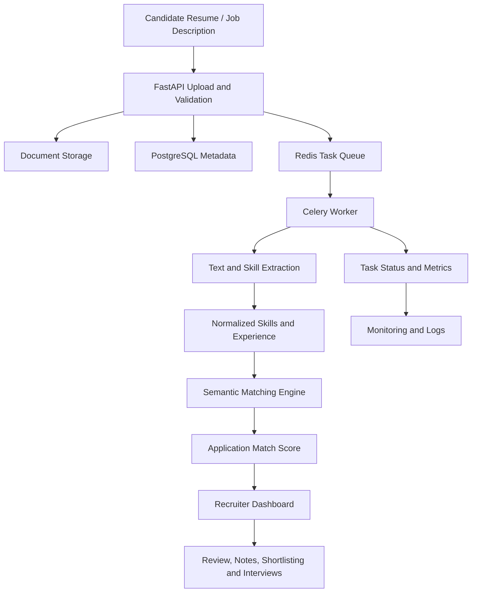

# TalentMatch- AI-Assisted Recruitment & Resume Screening

**An end-to-end recruitment management platform that combines resume intelligence, job management, candidate matching, and hiring workflow automation.**

TalentMatch is a full-stack recruitment platform built with React, FastAPI, PostgreSQL, and asynchronous AI-powered processing. It helps recruitment teams manage job postings, process resumes, evaluate candidate-job compatibility, track applications, and make more informed screening decisions through structured matching scores and candidate evidence.

Beyond its recruitment features, TalentMatch incorporates role-based access control (RBAC), company-scoped data access, configurable LLM integrations, background task processing, audit trails, and production-oriented observability.

---

## Table of Contents

- [Overview](#overview)
- [Key Features](#key-features)
- [How TalentMatch Works](#how-talentmatch-works)
- [Candidate Matching Engine](#candidate-matching-engine)
- [User Roles and Access Control](#user-roles-and-access-control)
- [Technical Architecture](#technical-architecture)
- [Technology Stack](#technology-stack)
- [Security and Reliability](#security-and-reliability)
- [Monitoring and Observability](#monitoring-and-observability)
- [Getting Started](#getting-started)
- [Configuration](#configuration)
- [Running with Docker](#running-with-docker)
- [API Documentation](#api-documentation)
- [Testing and Evaluation](#testing-and-evaluation)
- [Project Structure](#project-structure)
- [Engineering Highlights](#engineering-highlights)
- [Future Enhancements](#future-enhancements)
- [License](#license)

---

## Overview

Recruitment teams often spend significant time reviewing resumes, comparing candidate qualifications against job descriptions, managing application pipelines, and coordinating hiring decisions.

TalentMatch brings these workflows into a centralized application.

Recruiters can create and manage job openings, upload candidate resumes, evaluate candidate-job compatibility, review application progress, maintain private screening notes, and manage interview stages. Candidates can maintain their profiles, upload resumes, discover available jobs, submit applications, and track their progress.

The platform combines conventional backend engineering with NLP-based skill extraction, embedding-based semantic matching, configurable LLM integrations, and asynchronous processing.

### Core objectives

- **Improve screening efficiency:** Automate resume and job-description processing.
- **Evaluate skills in context:** Compare candidate qualifications with job requirements rather than relying exclusively on literal keyword overlap.
- **Make matching more interpretable:** Surface match scores, skill evidence, and experience signals to support recruiter review.
- **Centralize hiring workflows:** Manage jobs, applications, candidate pipelines, and interviews in one place.
- **Enforce secure access:** Apply role-based permissions and company-level data isolation.
- **Support operational visibility:** Provide health checks, structured logs, application metrics, and background-task monitoring.

---

## Key Features

### 1. Authentication and Account Management

- User registration and login.
- JWT-based authentication.
- Password hashing and verification.
- Authenticated user profiles and profile updates.
- Password changes with current-password verification.
- Account deletion with password confirmation and ownership safeguards.
- Failed-login protection and rate limiting.
- Token revocation through a token blacklist.
- Controlled role-request and approval workflows.
- Administrative user management and account-status controls.

### 2. Role-Based Access Control (RBAC)

TalentMatch separates platform administration, recruiter operations, and candidate functionality.

Permissions are enforced on the backend rather than relying solely on frontend navigation or hidden controls.

- Superuser-level platform administration.
- Administrative management within assigned company boundaries.
- Recruiter access to authorized jobs and their associated applications.
- Candidate access to their own profile, resumes, and applications.
- Protected recruiter notes and manual evaluation scores.
- Role-aware dashboard data and API responses.
- Company-scoped authorization for relevant resources.

### 3. Job Management

Recruiters can manage the job lifecycle through the application.

- Create, view, update, and manage job postings.
- Maintain job descriptions and role requirements.
- Configure employment type, location, remote-work type, department, and seniority.
- Manage job publication status.
- Search and filter jobs.
- Paginate job listings.
- Associate jobs with the appropriate company.
- Extract skills from job descriptions asynchronously.
- Trigger candidate rescoring when relevant job requirements change.

### 4. Resume Library and Document Processing

TalentMatch supports PDF and DOCX resume uploads.

- Individual and bulk resume uploads.
- Candidate-owned and recruiter-managed resume records.
- File-type and file-signature validation.
- File-size limits and bounded request processing.
- Resume storage through a configurable storage abstraction.
- Local storage for development and Azure Blob Storage integration.
- Background resume-text and skill extraction.
- Extraction status tracking and failure reporting.
- Resume download and storage cleanup operations.
- Batched uploads with configurable concurrency to control memory usage and storage pressure.

The bulk-upload pipeline stages and validates files before committing their database records, helping prevent invalid uploads from silently becoming usable resume entries.

### 5. AI-Assisted Job Description Processing

Job descriptions are processed to identify the technical skills relevant to a position.

- Extract and normalize skill requirements from job descriptions.
- Clean and prepare job-description text before extraction.
- Use an LLM-backed extraction pipeline.
- Process extraction tasks asynchronously.
- Track extraction status and failures.
- Configure the provider and model used for job-description extraction independently of resume-skill extraction.
- Apply request and token-rate controls to external LLM calls.

### 6. Candidate-Job Matching

The matching engine compares extracted resume skills and experience against job requirements.

- Match exact skills after alias normalization.
- Use semantic similarity to recognize related technical skills.
- Evaluate experience alongside skill compatibility.
- Distinguish evidence from work experience, projects, and skills-section mentions.
- Calculate a normalized candidate-job match score.
- Rank applicants for recruiter review.
- Support configurable scoring weights and similarity thresholds.
- Recalculate scores when matching inputs change.
- Process scoring tasks through background workers.

Matching results are intended to support human screening, not to replace recruiter judgment.

### 7. Application Management

- Apply for available jobs.
- Prevent applications from being created without a sufficiently processed resume.
- Track application status and shortlist progression.
- Support recruiter-driven status updates.
- Maintain interview stages and scheduled interview details.
- View applicant lists associated with authorized jobs.
- Filter, search, and paginate application records.
- Perform supported bulk-application workflows.
- Trigger scoring and rescore operations.
- Preserve application changes in the audit trail.

### 8. Recruiter Tools

Recruiters receive dedicated tools to manage the candidate pipeline.

- Review candidate applications and match scores.
- Inspect available matching evidence.
- Add private notes to individual applications.
- Set or update manual evaluation scores.
- Advance candidates through shortlist and interview stages.
- Schedule and track interviews.
- Revisit candidate and job information from the hiring dashboard.
- Export supported application and audit data where enabled in the frontend.

Private notes and manual evaluation scores are restricted to authorized recruiter and administrative workflows; they are not exposed through candidate-facing endpoints.

### 9. Role-Aware Dashboards and Analytics

The overview API returns dashboard data according to the authenticated user's role.

Depending on the user's permissions, the dashboard can surface relevant information about:

- Job postings and their statuses.
- Applications and their progress.
- Resume-processing states.
- Candidate pipeline activity.
- Upcoming scheduled interviews.
- Administrative platform health and processing activity.
- Recruitment and system activity within the user's permitted scope.

Dashboard totals use database aggregation queries where appropriate, avoiding the need to load every underlying record into application memory just to calculate counts.

### 10. LLM Configuration Management

TalentMatch provides an administrative interface for configuring supported LLM providers and models.

- Maintain task-specific provider and model selections.
- Configure resume-skill extraction independently from job-description skill extraction.
- Retrieve the supported provider list.
- Update task configurations through protected API endpoints.
- Probe configured integrations.
- Track configuration changes through audit events.
- Keep provider credentials in environment configuration rather than storing API secrets in ordinary database configuration records.

Supported integrations depend on the provider registry and the credentials available in the deployment environment. The configuration supports Hugging Face, OpenAI, and Groq integrations.

### 11. Audit Trail

Important changes are recorded to support traceability and administrative review.

- Track create, update, and delete operations where instrumented.
- Record the acting user where available.
- Store resource identifiers and before/after snapshots.
- Identify changed fields for supported updates.
- Record sensitive administrative and account-management events without exposing password hashes.
- Scope audit visibility by role, company, and job ownership.
- Exclude bulky internal matching payloads from audit responses where they are unnecessary.

Audit access is permission-controlled: a user cannot obtain unrestricted visibility into other recruiters' activity or other companies' records simply by querying the audit endpoint.

### 12. Background Processing

Resume extraction, job-description extraction, and candidate scoring are handled through asynchronous task workflows.

- FastAPI handles HTTP requests and dispatches work.
- Redis acts as the Celery broker and result backend.
- Celery workers process extraction and matching jobs.
- Celery Beat schedules periodic recovery and retry sweeps.
- Extraction and scoring queues can be routed separately from ordinary application requests.
- Task failures and processing states are tracked.
- Retry sweeps help recover eligible work that remains pending or has failed.
- Batch dispatch and rate limiting help control processing pressure.

This architecture prevents expensive document-processing and LLM operations from needing to run entirely inside the original HTTP request.

### 13. Monitoring and Observability

TalentMatch includes operational instrumentation for investigating application and processing health.

**Health endpoints**

- API liveness.
- PostgreSQL connectivity.
- Redis connectivity.
- Celery worker availability and queue depth.
- LLM provider/model configuration status.

**Prometheus metrics**

The metrics endpoint exposes measurements including:

- HTTP request counts by method, route, and status.
- HTTP request-duration histograms.
- Background-task execution counts and durations.
- Queue depth.
- Stuck or failed processing rows.
- Redis availability.
- LLM quota and rate-limit events.

**Structured logging**

- JSON logging for production-oriented deployments.
- Request IDs returned through the `X-Request-ID` response header.
- Request and background-task correlation.
- Error details for troubleshooting extraction and matching failures.
- Configurable log levels and formats.

The monitoring design supports integration with Prometheus, Grafana, and external uptime-monitoring tools. Metrics access is protected by configuration in production.

### 14. Frontend Experience

The React application provides a dedicated interface for candidate and recruiter workflows.

- Client-side routing.
- Authentication context and protected routes.
- Shared API client for backend communication.
- Reusable interface components.
- Consistent form, modal, notification, and status patterns.
- Dashboard and job-management views.
- Candidate and application-management screens.
- Administrative user, audit-history, and LLM-configuration views.
- Theme-aware styling and typography.

The frontend is built with Vite and Tailwind CSS, with shared design conventions to keep the interface consistent across features.

---

## How TalentMatch Works

The following illustrates the principal data flow from document ingestion to recruiter review.



### Processing stages

1. **Ingestion:** Accept a resume or job description and validate the incoming content.
2. **Storage:** Store the document using the configured storage backend and persist its metadata.
3. **Dispatch:** Queue the relevant extraction task for asynchronous processing.
4. **Extraction:** Parse the document and identify skills and relevant experience.
5. **Matching:** Compare extracted resume evidence with the requirements of the job.
6. **Scoring:** Compute the configured match score and persist the result.
7. **Review:** Present the candidate's results to authorized recruiters.
8. **Follow-up:** Support notes, application-status changes, shortlisting, and interview tracking.

---

## Candidate Matching Engine

TalentMatch uses a hybrid matching approach that combines normalized skill matching, semantic similarity, and experience scoring.

### Skill matching

Skills are normalized using canonical names and aliases. Exact normalized matches receive full similarity credit; related skills can receive partial credit based on embedding cosine similarity.

The implementation supports the `sentence-transformers/all-MiniLM-L6-v2` embedding model through a local or configured Hugging Face inference backend.

### Evidence-aware scoring

Where a skill appears in a resume affects how much evidence it contributes:

| Evidence source | Default weight |
|---|---:|
| Work experience | 1.00 |
| Projects | 0.70 |
| Skills-section mention | 0.35 |

A skill demonstrated in work experience is treated as stronger evidence than a skill that is merely listed. The best available evidence source is used for a given skill.

### Score composition

The default overall match score combines skill compatibility and experience:

\[
\text{Match Score} =
100 \times
(w_s S + w_e E)
\]

Where:

- \(S\) is the normalized skills score.
- \(E\) is the normalized experience score.
- \(w_s\) is the skills weight.
- \(w_e\) is the experience weight.

The default weights are:

| Component | Weight |
|---|---:|
| Skills compatibility | 55% |
| Experience | 45% |

The weights are configurable, and the implementation normalizes their ratio.

The skills component incorporates coverage, evidence strength, and balance across job requirements. Additional supporting skills can contribute partial credit, while unsupported requirements lower the resulting score.

The experience component uses a configurable saturation curve so that additional years of experience contribute progressively smaller increments rather than increasing the score without limit.

### Why this approach matters

- **Beyond literal keywords:** Related skills can be recognized through semantic similarity.
- **Evidence-aware:** The context in which a skill appears affects its contribution.
- **Experience-sensitive:** Skills and experience are evaluated together.
- **Configurable:** Scoring weights and similarity thresholds can be adjusted.
- **Review-oriented:** Scores help prioritize candidates without automatically disqualifying everyone below a threshold.

**Important:** Scores are estimates based on available resume evidence and configured matching rules. They are not proof of ability, and should not be treated as an automatic hiring decision.

---

## User Roles and Access Control

TalentMatch implements four principal account roles.

| Role | Primary responsibilities |
|---|---|
| Superuser | Platform-wide administration, privileged role management, and global configuration |
| Admin | Administrative operations within authorized company boundaries |
| Recruiter | Job management, applicant review, notes, scoring, shortlisting, and interviews for authorized jobs |
| User / Candidate | Profile management, resume uploads, job discovery, applications, and application tracking |

Role requests can be reviewed and approved through the administrative workflow. Public registration does not directly grant privileged recruiter or administrator permissions.

Access checks are enforced on backend routes and resource queries. Company and job ownership constraints further restrict access to sensitive resources.

---

## Technical Architecture

TalentMatch follows a separation-of-concerns architecture.

| Layer | Responsibility |
|---|---|
| React frontend | User interface, navigation, forms, dashboards, and recruiter workflows |
| FastAPI backend | REST APIs, authentication, authorization, validation, and business logic |
| PostgreSQL | Users, jobs, resumes, applications, configurations, and audit records |
| SQLAlchemy | ORM and database access |
| Alembic | Versioned database schema migrations |
| Redis | Celery message broker, task results, and shared rate-limiting support |
| Celery workers | Resume extraction, job-description extraction, and candidate scoring |
| Celery Beat | Periodic processing and recovery tasks |
| Local / Azure storage | Resume document storage |
| LLM providers | Configurable skill-extraction workflows |
| Sentence Transformers | Embedding-based semantic matching |
| Prometheus | Application and background-processing metrics |
| Docker Compose | Multi-service local deployment |

### Architectural principles

- Keep business logic and data access in the backend.
- Separate document processing from latency-sensitive HTTP requests.
- Use a storage abstraction to switch between local and Azure-backed storage.
- Make LLM configuration task-specific.
- Enforce authorization at the API and resource level.
- Use database aggregation for dashboard summaries.
- Track processing failures and operational health.
- Manage schema changes through migrations rather than automatic schema creation at application startup.

---

## Technology Stack

### Frontend

- React 18
- Vite
- React Router
- Tailwind CSS
- Axios
- Inter and Cormorant Garamond fonts

### Backend

- Python
- FastAPI
- Pydantic and Pydantic Settings
- SQLAlchemy
- Alembic
- PostgreSQL
- Psycopg
- JWT authentication and password hashing

### AI and document processing

- Hugging Face integrations
- Sentence Transformers
- `all-MiniLM-L6-v2` embeddings
- Configurable OpenAI and Groq integrations
- PDF and DOCX text extraction

### Infrastructure and operations

- Docker and Docker Compose
- Redis
- Celery and Celery Beat
- Azure Blob Storage integration
- Prometheus metrics
- Structured JSON logging
- GitHub Actions CI

---

## Security and Reliability

TalentMatch incorporates multiple safeguards across the API, storage, and background-processing layers.

### Authentication and authorization

- JWT-protected endpoints.
- Hashed passwords.
- Privileged-role restrictions.
- Role-aware and company-scoped access checks.
- Token blacklist support.
- Failed-login and request rate limiting.

### Input and file safety

- File content-type and signature validation.
- Resume upload-size limits.
- Request-body size ceilings.
- Escaped wildcard handling for search input.
- Schema-based request validation.
- Protected document download operations.

### Operational resilience

- Database, Redis, and worker health checks.
- Background-task status tracking.
- Retry and recovery workflows.
- Bounded bulk-upload processing.
- Configurable LLM request and token limits.
- Rescore batching and duplicate-dispatch protection.
- Docker health checks and persistent data volumes.
- Request-ID correlation across API and worker logs.

### Sensitive-data handling

- Provider credentials are supplied through environment configuration.
- Private recruiter notes are excluded from candidate-facing endpoints.
- Audit responses omit unnecessary bulky matching data.
- Production metrics access is protected.
- Production API documentation can be disabled through application configuration.

These controls reduce common operational and authorization risks but do not, by themselves, constitute a formal security certification.

---

## Monitoring and Observability

The backend provides health endpoints for the API and its dependencies.

| Endpoint | Purpose |
|---|---|
| `GET /api/health` | API health |
| `GET /api/health/db` | PostgreSQL connectivity |
| `GET /api/health/redis` | Redis availability |
| `GET /api/health/worker` | Celery worker availability and queue information |
| `GET /api/health/llm` | LLM configuration health |
| `GET /metrics` | Prometheus metrics |
| `GET /api/v1/admin/health-metrics` | Protected administrative health metrics |

The `/metrics` endpoint is hidden from the public OpenAPI schema and requires the configured bearer token in production. If no token is configured, the endpoint is disabled in production.

See [`backend/MONITORING.md`](backend/MONITORING.md) for example monitoring setups, metrics, and alerting guidance.

---

## Getting Started

### Prerequisites

Install the following before running the application locally:

- Python 3.12 or a compatible version supported by the backend dependencies.
- Node.js and npm.
- PostgreSQL 16 or a compatible PostgreSQL installation.
- Redis 7 or a compatible Redis installation.
- Git.

Docker Desktop with Docker Compose is the recommended alternative for starting the complete service stack.

External LLM integrations and Azure Blob Storage require their respective credentials when those integrations are enabled.

### 1. Clone the repository

```bash
git clone https://github.com/twopranav/TalentMatch.git
cd TalentMatch
```

### 2. Configure the backend

Create and activate a Python virtual environment.

**Windows PowerShell**

```powershell
cd backend
python -m venv .venv
.\.venv\Scripts\Activate.ps1
```

**Linux / macOS**

```bash
cd backend
python3 -m venv .venv
source .venv/bin/activate
```

Install the dependencies using the dependency file provided by the repository:

```bash
pip install -r requirements.txt
```

If the dependency file is maintained at the repository root in your checkout, run the install command against that root-level file instead.

Create `backend/.env` from the repository's environment template, where available, and configure the database, JWT secret, Redis connection, storage backend, and required provider credentials.

For a local PostgreSQL instance, create the `talentdb` database or configure `DATABASE_URL` to point to your chosen database.

### 3. Run database migrations

From the backend directory:

```bash
alembic upgrade head
```

Migrations must be applied before starting an installation whose database schema has not yet been initialized.

### 4. Start the API

From the backend directory with the virtual environment activated:

```bash
uvicorn app.main:app --reload
```

The API should be available at:

- Application root: `http://localhost:8000/`
- Health check: `http://localhost:8000/api/health`
- Database health: `http://localhost:8000/api/health/db`
- Interactive API documentation in development: `http://localhost:8000/docs`

Redis must be available for the features that depend on background processing and shared rate limiting.

### 5. Start the background worker

In a separate terminal, activate the same virtual environment and run from the backend directory:

```bash
celery -A app.core.celery_app worker -Q llm,celery --loglevel=info --concurrency=1
```

The worker processes queued extraction, matching, and maintenance tasks.

### 6. Start Celery Beat

In another terminal:

```bash
celery -A app.core.celery_app beat --loglevel=info
```

Beat schedules periodic processing and recovery jobs. Run a single Beat instance for a deployment to avoid duplicate periodic dispatches.

### 7. Start the frontend

In a separate terminal:

```bash
cd frontend
npm install
npm run dev
```

Open `http://localhost:5173` in your browser.

Ensure the frontend API configuration points to the backend at `http://localhost:8000` and that the backend CORS configuration allows the frontend origin.

---

## Configuration

The backend uses Pydantic Settings and environment variables for deployment-specific configuration.

Store secrets in `backend/.env` for local development. Do not commit actual credentials.

| Variable | Purpose |
|---|---|
| `ENV` | Environment mode, such as development or production |
| `DEBUG` | Debug behavior; must be disabled in production |
| `DATABASE_URL` | PostgreSQL connection string |
| `JWT_SECRET_KEY` | Secret used for JWT signing |
| `JWT_ALGORITHM` | JWT algorithm |
| `ACCESS_TOKEN_EXPIRE_MINUTES` | Access-token lifetime |
| `REDIS_URL` | Redis connection |
| `STORAGE_BACKEND` | `local` or `azure` |
| `LOCAL_STORAGE_ROOT` | Local resume-storage directory |
| `AZURE_STORAGE_SAS_URL` | Azure storage access configuration |
| `HF_TOKEN` | Hugging Face credentials, when required |
| `OPENAI_API_KEY` | OpenAI credentials, when required |
| `GROQ_API_KEY` | Groq credentials, when required |
| `EMBEDDING_PROVIDER` | Local or Hugging Face embedding backend |
| `EMBEDDING_MODEL` | Embedding model identifier |
| `MATCH_WEIGHT_SKILLS` | Skills contribution to the matching score |
| `MATCH_WEIGHT_EXPERIENCE` | Experience contribution to the matching score |
| `LLM_RPM_LIMIT` | Configured LLM requests-per-minute limit |
| `LLM_TPM_LIMIT` | Configured LLM tokens-per-minute budget |
| `METRICS_TOKEN` | Optional bearer token protecting Prometheus metrics |
| `LOG_LEVEL` | Logging verbosity |
| `LOG_FORMAT` | Logging format, including JSON |
| `CORS_ORIGINS` | Permitted frontend origins |

The backend also supports configuration for upload limits, bulk-processing concurrency, retry behavior, rescore batching, and task timeouts. See [`backend/app/core/config.py`](backend/app/core/config.py) for the authoritative defaults.

**Security note:** Use a strong, unique JWT secret in production, disable debug mode, restrict CORS to trusted origins, and keep database, Redis, and storage credentials out of version control. Review provider-specific settings before enabling external AI services.

---

## Running with Docker

The repository includes a Docker Compose configuration for the main services:

- PostgreSQL
- Redis
- FastAPI backend
- Celery worker
- Celery Beat scheduler

From the repository root, configure `backend/.env` and start the services:

```bash
docker compose up --build -d
```

Apply database migrations as a separate one-off operation:

```bash
docker compose run --rm backend alembic upgrade head
```

Inspect service status:

```bash
docker compose ps
```

Follow backend logs:

```bash
docker compose logs -f backend
```

Follow worker logs:

```bash
docker compose logs -f worker
```

Follow Beat logs:

```bash
docker compose logs -f beat
```

The Compose configuration defines persistent volumes for PostgreSQL and locally stored resumes, health checks, service dependencies, and bounded Docker JSON log rotation.

The API is exposed on port `8000`. The Vite development frontend is typically run separately on port `5173`.

Do not use the example database credentials from the Compose file as production credentials. Configure appropriate secrets, access restrictions, storage settings, and network boundaries for production deployments.

---

## API Documentation

The backend exposes REST APIs for authentication, users, jobs, resumes, applications, overview dashboards, audit history, LLM configuration, health checks, and monitoring.

Principal API route groups include:

| Route prefix | Purpose |
|---|---|
| `/api/auth` | Registration, login, and authentication workflows |
| `/api/users` | Profiles, user management, and role-related operations |
| `/api/jobs` | Job creation, retrieval, and management |
| `/api/resumes` | Resume library and document operations |
| `/api/v1/resumes` | Versioned resume endpoints |
| `/api/applications` | Applications, status changes, and interview workflows |
| `/api/v1/overview` | Role-aware dashboard aggregates |
| `/api/audit` | Authorized audit-trail access |
| `/api/admin/llm-config` | LLM configuration management |
| `/api/v1/admin/health-metrics` | Administrative system metrics |

In development, open `http://localhost:8000/docs` to explore the generated OpenAPI documentation.

Production mode disables the interactive documentation endpoints by default. Individual endpoint availability depends on authentication, authorization, and configuration.

---

## Testing and Evaluation

The repository includes job-description extraction evaluation resources, including a gold dataset and an evaluation runner.

Relevant files include:

- [`backend/evals/jd_gold.py`](backend/evals/jd_gold.py)
- [`backend/evals/jd_eval.py`](backend/evals/jd_eval.py)
- [`backend/MONITORING.md`](backend/MONITORING.md)

The JD evaluation tooling is intended to compare extracted skills with expected results and help investigate difficult document layouts and extraction behavior.

The repository also includes a GitHub Actions workflow for CI.

Before deploying a change, validate the affected backend routes, database migrations, frontend build, authorization boundaries, extraction tasks, and relevant evaluation cases.

---

## Project Structure

```text
TalentMatch/
├── .github/
│   └── workflows/
│       └── ci.yml
├── backend/
│   ├── alembic/
│   │   └── versions/
│   ├── app/
│   │   ├── api/
│   │   │   └── routes/
│   │   ├── core/
│   │   ├── db/
│   │   ├── models/
│   │   ├── prompts/
│   │   ├── schemas/
│   │   └── main.py
│   ├── evals/
│   ├── MONITORING.md
│   └── Dockerfile
├── frontend/
│   ├── src/
│   │   ├── api/
│   │   ├── components/
│   │   ├── context/
│   │   ├── hooks/
│   │   ├── pages/
│   │   └── main.jsx
│   ├── package.json
│   └── vite.config.js
├── scripts/
├── docker-compose.yml
├── matching_bundle.txt
├── tree.py
└── README.md
```

The tree above is a high-level overview. Individual folders contain additional route modules, model definitions, utilities, schemas, and supporting files.

---

## Engineering Highlights

TalentMatch demonstrates more than basic CRUD development.

- **Full-stack application design:** React frontend integrated with a modular FastAPI backend.
- **Database-backed access control:** Role and resource authorization enforced on the server.
- **Semantic matching:** Embedding-based similarity combined with normalized skill matching.
- **Evidence-aware scoring:** Work experience, project evidence, and skills-section mentions contribute differently.
- **Asynchronous workloads:** Redis and Celery separate extraction and matching from HTTP request handling.
- **Configurable AI integrations:** Task-specific provider/model selection and LLM quota controls.
- **Cloud-ready storage:** Local and Azure Blob Storage implementations behind a common interface.
- **Operational observability:** Prometheus metrics, health probes, structured logs, and request-ID tracing.
- **Auditable workflows:** Before/after snapshots and access-controlled audit history.
- **Controlled bulk operations:** Bounded upload memory, concurrency limits, and batched scoring dispatch.
- **Migration-driven schema management:** Alembic migrations and explicit deployment-time migration steps.
- **Containerized services:** Docker Compose orchestration with health checks and persistent volumes.
- **Document extraction evaluation:** Gold examples and evaluation tooling for testing JD skill extraction.

Together, these capabilities demonstrate practical experience in backend engineering, AI integration, database design, security, asynchronous systems, and operational tooling.

---

## Future Enhancements

Potential areas for continued development include:

- Expanded automated end-to-end testing of complete recruitment workflows.
- More detailed candidate-facing explanations of matching evidence.
- Additional fairness and bias evaluations for screening workflows.
- Organization-specific scoring presets and configurable evaluation criteria.
- More advanced recruitment analytics and configurable reporting.
- Additional integrations with calendars, email, and external recruitment systems.
- Deployment automation and production infrastructure templates.
- Performance benchmarking under realistic concurrent workloads.

These are potential extensions rather than claims about currently implemented features.

---

## License

Add the repository's chosen license here and include its corresponding license file. Until a license is present, do not assume the project is open source or available for unrestricted reuse.

---

**Built with React, FastAPI, PostgreSQL, and AI-assisted document processing.**
